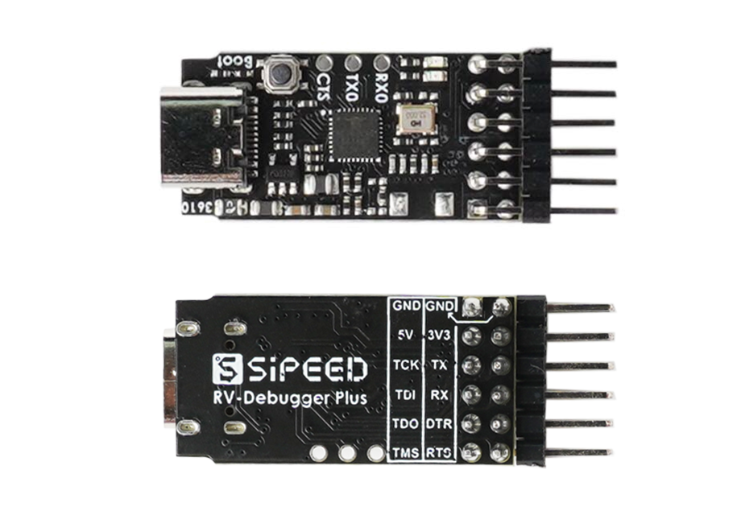

# Description

**RV-Debugger-BL702** is an opensource project that implement a JTAG+UART debugger with BL702C-A0.

[BL702](https://www.bouffalolab.com/bl70X) is highly integrated BLE and Zigbee combo chipset for IoT applications, contains **32-bit RISC-V** CPU with FPU, frequency up to **144MHz**, with **132KB RAM** and **192 KB ROM**, 1Kb eFuse, **512KB embedded Flash**, USB2.0 FS device interface, and many other features.

The firmware implement is inspired by [open-ec](https://github.com/rgwan/open-ec), implement by Sipeed teams and community developers.

The firmware emulate an [FT2232D](https://ftdichip.com/products/ft2232d/) device, defaultly implement an JTAG+UART debugger, and can be implement as a Dual-Serial Port debugger, a bluetooth debugger, etc. 

Community Forum:  bbs.sipeed.com

# Hardware
## Offical Board

Sipeed RV-Debugger-Plus  (BL702C-A0)

Purchase link: Aliexpress

Schematic: [BL702_USB2JTAG_3610_sch.pdf](hardware/BL702_USB2JTAG_3610_sch.pdf)

Assembly: [BL702_USB2JTAG_3610_asm.pdf](hardware/BL702_USB2JTAG_3610_asm.pdf)

(LED0 is the led close to edge, indicate for RX)


<br />

## Third-party Hardware

TODO

# Firmware
## build firmware

To build usb2uartjtag firmware:

~~~
cd firmware/bl_mcu_sdk
make clean
make BOARD=bl702_debugger APP_DIR=../app APP=usb2uartjtag
~~~

The firmware is './out/app/usb2uartjtag/usb2uartjtag_bl702.bin'.

To build usb2dualuart firmware:

~~~
cd firmware/bl_mcu_sdk
make clean
make BOARD=bl702_debugger APP_DIR=../app APP=usb2dualuart
~~~
The firmware is './out/app/usb2dualuart/usb2dualuart_bl702.bin'.

## flash firmware

Hold "boot" button down, then plug usb cable to PC USB port, and you will see "CDC Virtual ComPort" in device manager , remember the com number.

The flash tool is in tools/bflb_flash_tool directory, and input the command (replace port number and firmware name):

Windows:
~~~
.\bflb_mcu_tool.exe --chipname=bl702 --port=COM9 --xtal=32M --firmware="<path to firmware.bin>"
~~~

Linux:
~~~
./bflb_mcu_tool --chipname=bl702 --port=/dev/ttyACM0 --xtal=32M --firmware="<path to firmware.bin>"
~~~

The output looks like:
~~~
tools\bflb_flash_tool> .\bflb_mcu_tool.exe --chipname=bl702 --port=COM9 --xtal=32M --firmware="main.bin"
[22:07:28.296] - ==================================================
[22:07:28.296] - Chip name is bl702
[22:07:28.297] - Serial port is COM9
[22:07:28.299] - Baudrate is 115200
[22:07:28.299] - Firmware is main.bin
[22:07:28.300] - Default flash clock is 72M
[22:07:28.300] - Default pll clock is 144M
[22:07:28.311] - ==================================================
[22:07:28.483] - Update flash cfg finished
[22:07:28.500] - EFUSE_CFG
[22:07:28.500] - BOOTHEADER_CFG
......
[22:07:31.274] - Load 53856/53856 {"progress":100}
[22:07:31.274] - Write check
[22:07:31.274] - Flash load time cost(ms): 267.942626953125
[22:07:31.275] - Finished
[22:07:31.276] - Sha caled by host: 825d198270c2cf509acda8f8e0830751c532da802060c324a4479e1fe599ae1f
[22:07:31.276] - xip mode Verify
[22:07:31.288] - Read Sha256/53856
[22:07:31.288] - Flash xip readsha time cost(ms): 12.508056640625
[22:07:31.288] - Finished
[22:07:31.288] - Sha caled by dev: 825d198270c2cf509acda8f8e0830751c532da802060c324a4479e1fe599ae1f
[22:07:31.288] - Verify success
[22:07:31.289] - Program Finished
[22:07:31.289] - All time cost(ms): 2220.2548828125
[22:07:31.390] - [All Success]
~~~

Another GUI flash tool is BouffaloLabDevCube:
- [Bouffalo Lab Dev Cube For Windows](https://dev.bouffalolab.com/media/upload/download/BouffaloLabDevCube-1.5.2-win32.zip)
- [Bouffalo Lab Dev Cube For Ubuntu](https://dev.bouffalolab.com/media/upload/download/BouffaloLabDevCube-1.5.2-linux-x86.tar.gz)

## usb2uartjtag (default)

Support JTAG+UART function

### Windows openFPGALoader

The usb2uartjtag firmware uses USB device revision `0501`. Interface A is the
JTAG/MPSSE interface and interface B is the UART interface. On Windows,
openFPGALoader uses libusb, so interface A must use WinUSB. Interface B can
continue using the FTDI serial driver.

The driver package matches only this hardware ID:

~~~
USB\VID_0403&PID_6010&REV_0501&MI_00
~~~

It therefore does not match a real FT2232H with revision `0500`. To generate,
sign, and install the development driver, install the Windows Driver Kit and
run the following from an elevated PowerShell prompt:

~~~powershell
Set-ExecutionPolicy -Scope Process Bypass
.\driver\windows\install-development-driver.ps1
~~~

The script installs a local development certificate. It checks that connected
real FTDI `REV_0500` interface-A devices still use `FTDIBUS` after installation.

Find the BL702 bus/device number and then use interface A with openFPGALoader:

~~~powershell
openFPGALoader.exe --scan-usb
openFPGALoader.exe -c ft2232 --ftdi-channel 0 --busdev-num 001:018 --freq 1000000 --detect
openFPGALoader.exe -c ft2232 --ftdi-channel 0 --busdev-num 001:018 --freq 1000000 --write-sram design.fs
openFPGALoader.exe -c ft2232 --ftdi-channel 0 --busdev-num 001:018 --freq 1000000 --write-flash --reset design.fs
~~~

Replace `001:018` with the value printed by `--scan-usb`. The firmware serial
has the form `BL702_FTDI_<chip-id>`, so it can also be supplied with
`--ftdi-serial` when multiple probes are connected.

Interface B remains a normal FTDI serial port (`FTDIBUS` on Windows). Its USB
OUT endpoint `0x04` is bridged to UART1 TX/GPIO26 through DMA, and UART1
RX/GPIO27 is returned through USB IN endpoint `0x83`. Line coding and modem
control are isolated from interface A; FTDI reset/purge requests clear the
corresponding UART queues and FIFOs. On the Tang Nano 9K 3674 production
board, DTR/RTS/CTS are intentionally ignored: GPIO28 is `Boot_Strap`, GPIO24
is `LED_STATE`, and GPIO25 is NC. The default format is 115200 8N1.

### Tang Nano 9K 3674 production pin map

The production wiring follows the [Tang_nano_9K_3674 schematic](https://dl.sipeed.com/fileList/TANG/Nano%209K/2_Schematic/Tang_nano_9K_3674_schematics.pdf):

| Function | BL702 GPIO | FPGA/package net |
| --- | ---: | --- |
| UART1 TX | 26 | `FPGA_RX`, pin 18 (through R45) |
| UART1 RX | 27 | `FPGA_TX`, pin 17 (through R46) |
| JTAG TMS | 14 | `IOL11A_JTAG_TMS`, pin 5 |
| JTAG TCK | 23 | `IOL11B_JTAG_TCK`, pin 6 |
| JTAG TDI | 17 | `IOL12B_JTAG_TDI`, pin 7 |
| JTAG TDO | 15 | `IOL13A_JTAG_TDO`, pin 8 |
| Status LED | 24 | `LED_STATE` (active low) |

GPIO2 is left as an optional UART0 TX probe for development logs and is NC on
the production board; it is not part of the JTAG/UART functional route.

UART support baudrate below 2Mbps, and 3Mbps, and some experimental baudrate (stability is not guaranteed):

~~~
12M, 9.6M, 8M, 6.4M, 6M, 4.8M, 4M, 3.2M
we remap baudrate in 10000~12000 to (baud-10000)*10000
for example, 11200bps -> 12Mbps
~~~

The production board has one BL702 LED on GPIO24 (RX/TX indication).

### Gowin Programmer frequency and GAO

`--frequency` is the host-side JTAG TCK target used for bitstream
configuration/control/readback; it is not the GAO sample rate. The GAO sample
clock comes from the FPGA user design (`osc_clk` in the probe), and the GAO
capture transaction can request a separate JTAG TCK. The installed
`programmer_cli` help reports a 2.5 MHz default, although a GUI may retain a
15 MHz selection.

The current BL702 bridge consumes FTDI MPSSE `0x86` clock-divisor commands but
does not yet apply the divisor to its GPIO bit-banger. Therefore selecting
15 MHz does not make the physical TCK 15 MHz, but it still changes the host
MPSSE stream and timing assumptions. On the Tang Nano 9K fixture, 15 MHz SRAM
downloads passed with both WinUSB and FT2CH, and GAO capture passed through
FT2CH. The `gao_sh` WinUSB capture backend timed out after successful GAO
bitstream downloads at both 1 MHz and 15 MHz, so that capture issue is not
caused by the 15 MHz selection. Use FT2CH for GAO capture for now. The 15 MHz
embFlash operation failed, whereas the full embFlash and reload sequence
passed at 1 MHz; use 1 MHz for production embFlash and as the universal bridge
setting until divisor support is implemented.

JTAG function is verified for :

- RV32 Xuantie E906/E907
- RV64 Xuantie C906
- Gowin FPGA GW1N-1, GW1NS-4C. (need enable GOWIN_INT_FLASH_QUIRK)

## usb2dualuart
TODO.


# Project Structure

```
RV-Debugger-BL702
├── firmware
│   ├── app
│   │   ├── usb2dualuart
│   │   └── usb2uartjtag
│   └── bl_mcu_sdk
├── hardware
├── README.md
└── res
```
BL SDK usage tutorial refer to http://bouffalolab.gitee.io/bl_mcu_sdk/

### Code Explanation
~~~
firmware/app/usb2uartjtag:
├── main.c
├── uart_interface.c
├── jtag_process.c
└── io_cfg.h         //main io cfg, another file is pinmux_config.h in bsp/board/bl702_debugger
components/usb_stack/class/vendor:
└── usbd_ftdi.c      //all FTDI vendor request process, like baudrate set, dtr/rts set, Latency_Timer
~~~
